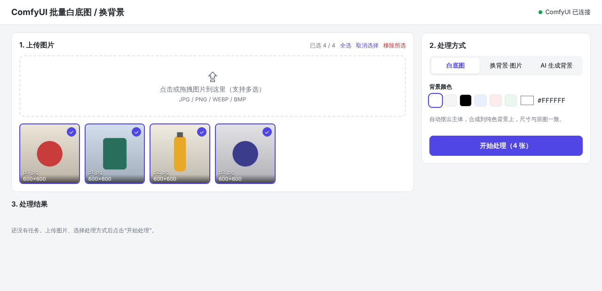

# ComfyUI 批量白底图 / 换背景

一个前后端分离的小工具：在网页里批量上传图片，调用 ComfyUI 自动抠图，然后

- **白底图**：合成到白色（或任意纯色）背景上；
- **换背景 · 图片**：合成到你上传的背景图上（自动按原图尺寸居中缩放裁剪）；
- **AI 生成背景**：用 SD 模型按提示词生成背景，再合成主体。

输出尺寸与原图一致，支持逐张下载、批次 ZIP 打包下载、失败重试。



```
浏览器 (Vue 3 + Vite)
   │  /api
   ▼
后端 (FastAPI) ── 任务队列 ── ComfyUI HTTP API
   │                          /upload/image → /prompt → /history → /view
   └─ data/uploads, data/results
```

> ⚠️ **项目状态**：后端和前端已用模拟的 ComfyUI 完整测试过（见 `backend/tests/`），
> 但**尚未在真实 ComfyUI 上验证**。抠图节点 `RMBG` 的输入参数是按 ComfyUI-RMBG 插件的接口编写的，
> 如果插件版本不同导致报错，请参考下方「常见问题」调整 `backend/workflows/*.json`。

## 环境要求

| 组件 | 版本 |
| --- | --- |
| Python | **3.10 及以上** |
| Node.js | **18 及以上**（仅构建/开发前端时需要） |
| ComfyUI | 近期版本，需安装 [ComfyUI-RMBG](https://github.com/1038lab/ComfyUI-RMBG) 节点 |
| Docker（可选） | Docker 20.10+ 与 Docker Compose **v2.24+** |

## 第一步：准备 ComfyUI

1. **安装抠图节点 ComfyUI-RMBG**：在 ComfyUI-Manager 里搜索 `RMBG` 安装，或手动：
   ```bash
   cd ComfyUI/custom_nodes
   git clone https://github.com/1038lab/ComfyUI-RMBG
   pip install -r ComfyUI-RMBG/requirements.txt   # 用 ComfyUI 自己的 Python 环境
   ```
   装好后重启 ComfyUI。抠图模型会在第一次使用时自动从 HuggingFace 下载。
   国内网络下载失败时，在**启动 ComfyUI 之前**设置镜像：
   ```bash
   export HF_ENDPOINT=https://hf-mirror.com          # Linux / macOS
   set HF_ENDPOINT=https://hf-mirror.com             # Windows CMD
   $env:HF_ENDPOINT="https://hf-mirror.com"          # Windows PowerShell
   ```
2. **（仅「AI 生成背景」需要）** 把 SD 模型放到 `ComfyUI/models/checkpoints/`。
   默认文件名是 `sd_xl_base_1.0.safetensors`，用别的模型请设置 `SD_CHECKPOINT`（见「配置」）。
3. **启动 ComfyUI**，默认地址 `http://127.0.0.1:8188`。以下两种情况必须加 `--listen 0.0.0.0`，否则后端连不上：
   - 后端和 ComfyUI 不在同一台机器；
   - 后端用 Docker 运行（容器访问宿主机不走 127.0.0.1）。
   ```bash
   python main.py --listen 0.0.0.0
   ```
   Windows 便携版可以编辑 `run_nvidia_gpu.bat`，在启动命令末尾加上 `--listen 0.0.0.0`。

### 关于抠图模型的许可证（商用必读）

默认模型 **RMBG-2.0 的许可证是 CC BY-NC 4.0，不允许商业使用**。电商商品图等商用场景请换成可商用的模型，例如：

| `RMBG_MODEL` | 许可证 | 说明 |
| --- | --- | --- |
| `RMBG-2.0` | CC BY-NC 4.0（非商用） | 默认，边缘效果好 |
| `BEN2` | MIT | 可商用，效果接近 RMBG-2.0 |
| `INSPYRENET` | MIT | 可商用 |

修改方法：在 `.env` 里写 `RMBG_MODEL=BEN2`。以上许可证信息仅供参考，请以各模型发布页为准。

## 第二步：配置

复制配置模板，按需修改（本地运行和 Docker 都会读取仓库根目录的 `.env`；这一步可选，不建 `.env` 就全部用默认值）：

```bash
cp .env.example .env        # Windows: copy .env.example .env
```

| 变量 | 默认值 | 说明 |
| --- | --- | --- |
| `COMFYUI_URL` | `http://127.0.0.1:8188` | ComfyUI 地址（Docker 下默认 `http://host.docker.internal:8188`） |
| `RMBG_MODEL` | `RMBG-2.0` | 抠图模型：`RMBG-2.0` / `BEN2` / `BEN` / `INSPYRENET` |
| `SD_CHECKPOINT` | `sd_xl_base_1.0.safetensors` | AI 生成背景用的模型文件名 |
| `MAX_CONCURRENCY` | `2` | 同时在途的任务数（ComfyUI 本身串行执行，调大不会更快，只是让上传/下载与推理重叠） |
| `JOB_TIMEOUT` | `600` | 单张图片最长等待秒数（首次运行要下载模型，可适当调大） |
| `MAX_UPLOAD_MB` | `30` | 单张上传上限 |
| `DATA_DIR` | `backend/data` | 上传与结果的存储目录 |
| `CORS_ORIGINS` | `*` | 允许跨域的来源，逗号分隔 |

系统环境变量的优先级高于 `.env`。

## 第三步：运行

### 方式一：Docker（推荐）

```bash
docker compose up -d --build
```

打开 <http://localhost:8000>。上传和结果文件保存在仓库下的 `data/` 目录。
ComfyUI 跑在宿主机时，记得按第一步用 `--listen 0.0.0.0` 启动。

### 方式二：直接运行

先构建前端，再启动后端（后端会自动托管 `frontend/dist`）：

**Linux / macOS**
```bash
cd frontend && npm install && npm run build && cd ..
cd backend
python3 -m venv .venv
source .venv/bin/activate
pip install -r requirements.txt
uvicorn app.main:app --host 0.0.0.0 --port 8000
```

**Windows（PowerShell）**
```powershell
cd frontend; npm install; npm run build; cd ..
cd backend
python -m venv .venv
.venv\Scripts\Activate.ps1      # CMD 下用 .venv\Scripts\activate.bat
pip install -r requirements.txt
uvicorn app.main:app --host 0.0.0.0 --port 8000
```

打开 <http://localhost:8000>。

### 方式三：开发模式（前端热更新）

```bash
# 终端 1：后端（激活虚拟环境后）
cd backend
pip install -r requirements-dev.txt
uvicorn app.main:app --reload --port 8000

# 终端 2：前端
cd frontend
npm install
npm run dev          # 打开 http://localhost:5173 ，/api 自动代理到 8000
```

运行测试（不需要 ComfyUI 和 GPU）：`cd backend && pytest`

## 使用方法

1. 确认右上角显示 **「ComfyUI 已连接」**（绿点）。
2. **上传图片**：点击或拖拽到上传区，可多选。上传后默认全部勾选，点缩略图可以取消/重新勾选。
3. **选择处理方式**：
   - **白底图**：选择背景颜色（默认白色，也可自定义任意颜色）；
   - **换背景·图片**：上传一张背景图，所有选中的图片都用它做背景；
   - **AI 生成背景**：填写背景描述（英文效果更好，可点下方预设），可调 Seed（-1 为每张随机）、步数、CFG。
4. 点击 **「开始处理（N 张）」**，在「处理结果」里查看每张图的进度，左边是原图，右边是结果。
5. 点结果图可以放大对比；单张点「下载」，整批点「下载 ZIP」；失败的任务可以点「重试」。

## 常见问题

**右上角显示「ComfyUI 未连接」**
- 检查 ComfyUI 是否已启动，`COMFYUI_URL` 是否正确（浏览器直接打开该地址应能看到 ComfyUI 界面）。
- 后端用 Docker 或跨机器访问时，ComfyUI 需加 `--listen 0.0.0.0` 启动，并放行 8188 端口防火墙。

**任务失败：「提交工作流失败」/「工作流节点错误」**
- 错误里出现 `RMBG` 或 `class_type`：没装 ComfyUI-RMBG 节点，或装完没重启 ComfyUI。
- 错误里出现 `model` 的取值不在列表中：`RMBG_MODEL` 写错了，或插件版本不支持该模型；
  在 ComfyUI 界面里添加一个 RMBG 节点，看它的 model 下拉框有哪些选项。
- 错误里出现 `ckpt_name`：`SD_CHECKPOINT` 对应的文件不在 `ComfyUI/models/checkpoints/` 里。
- 插件更新后节点参数变了：在 ComfyUI 里搭一遍同样的流程，用「Save (API Format)」导出，
  对照修改 `backend/workflows/` 下的模板（见下方「自定义工作流」）。

**任务失败：「ComfyUI 执行出错」**
- 常见原因是抠图模型下载失败（网络问题）或显存不足。查看 ComfyUI 控制台的完整报错；
  下载问题按第一步设置 `HF_ENDPOINT` 镜像。

**任务失败：「等待 ComfyUI 超时」**
- 第一次运行要下载模型，耗时较长，调大 `JOB_TIMEOUT` 后点「重试」。

**重启后端后任务列表没了**
- 任务和上传记录保存在内存中，重启会清空；已生成的文件仍在 `data/results/` 目录。

## 自定义工作流

`backend/workflows/` 下是 ComfyUI **API 格式**的 JSON
（在 ComfyUI 设置里开启开发者模式后，菜单「Save (API Format)」导出）：

| 文件 | 对应模式 |
| --- | --- |
| `white_bg.json` | 白底图 |
| `replace_bg_image.json` | 换背景·图片 |
| `replace_bg_prompt.json` | AI 生成背景 |

值**恰好**为 `{{KEY}}` 的字段会被后端替换，类型保持不变（数字仍是数字）：

| 占位符 | 含义 |
| --- | --- |
| `{{INPUT_IMAGE}}` | 已上传到 ComfyUI 的原图文件名 |
| `{{WIDTH}}` / `{{HEIGHT}}` | 原图尺寸 |
| `{{RMBG_MODEL}}` | 抠图模型 |
| `{{BG_COLOR}}` | 背景色（整数，如白色 `16777215`） |
| `{{BG_IMAGE}}` | 背景图文件名 |
| `{{CHECKPOINT}}` `{{PROMPT}}` `{{NEGATIVE}}` `{{SEED}}` `{{STEPS}}` `{{CFG}}` `{{GEN_WIDTH}}` `{{GEN_HEIGHT}}` | AI 背景生成参数 |

想换别的抠图节点（如 BiRefNet、rembg）、加上光影融合（IC-Light）或放大，只要改模板即可，
后端会取 `SaveImage` 节点的输出作为结果。

## 目录结构

```
backend/
  app/
    main.py          # FastAPI 路由
    jobs.py          # 上传记录、批次、异步任务队列
    comfy_client.py  # ComfyUI API 客户端
    workflows.py     # 工作流模板渲染
    config.py        # 配置（环境变量 / .env）
  workflows/         # ComfyUI API 格式的工作流模板
  tests/             # pytest（自带模拟 ComfyUI，不需要 GPU）
frontend/            # Vue 3 + Vite
docs/                # 截图
Dockerfile, docker-compose.yml, .env.example
```

## API

| 方法 | 路径 | 说明 |
| --- | --- | --- |
| GET | `/api/health` | 检查 ComfyUI 连接 |
| POST | `/api/uploads` | 批量上传（multipart，字段 `files`） |
| POST | `/api/batches` | 创建批次：`{image_ids, mode, bg_color?, background_id?, prompt?, negative_prompt?, seed?, steps?, cfg?}` |
| GET | `/api/batches` / `/api/batches/{id}` | 查询批次与任务状态 |
| GET | `/api/batches/{id}/download` | 下载批次结果 ZIP |
| POST | `/api/tasks/{id}/retry` | 重试失败任务 |
| GET | `/api/results/{task_id}` | 结果图（`?download=true` 作为附件下载） |

`mode` 取值：`white`、`replace_image`、`replace_prompt`。启动后访问 <http://localhost:8000/docs> 可查看交互式 API 文档。

## 说明

- 任务和上传记录保存在内存中，后端重启后列表会清空（文件仍在 `data/` 目录）。
- 上传的图片会按 EXIF 方向转正并统一存为 PNG。
